# Elli Flores Gestão — ERP web para floricultura

Sistema de gestão feito sob medida para uma floricultura de Rio Verde/GO: encomendas com agenda de entrega, estoque de flores com validade, PDV, financeiro, catálogo online, **catálogo exclusivo de atacado para lojistas**, emissão de NFC-e/NF-e e WhatsApp integrado.

> Este repositório é a **vitrine do projeto** (telas, funcionalidades e arquitetura). O código-fonte fica em repositório privado; demonstração ao vivo e acesso ao código para avaliação técnica sob solicitação. Todas as telas usam dados de demonstração.

## Vídeo de apresentação

🎬 **[Assistir ao vídeo narrado (9 min)](https://github.com/MarllusRobert/ElliFlores-Gestao/releases/latest/download/ElliFlores-Apresentacao-720p.mp4)** — todas as funcionalidades explicadas, tela por tela.

## Telas

| Login | Painel |
|---|---|
| 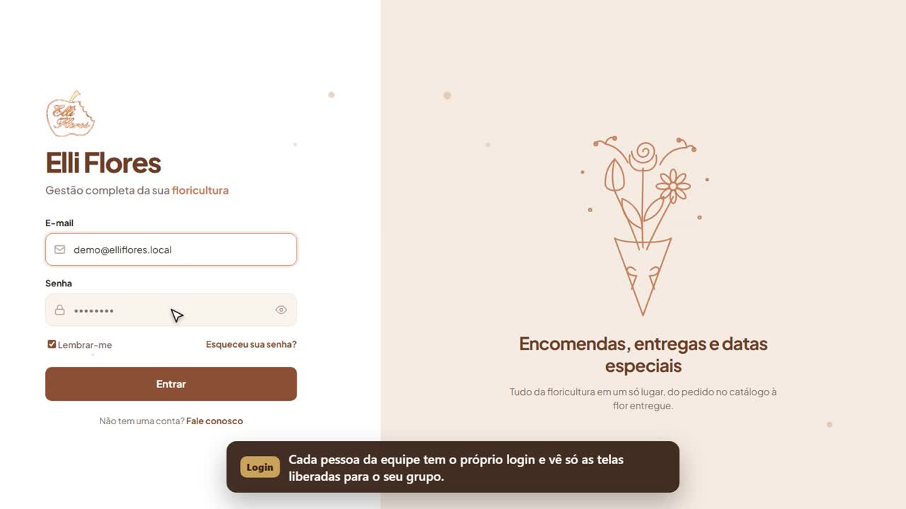 | 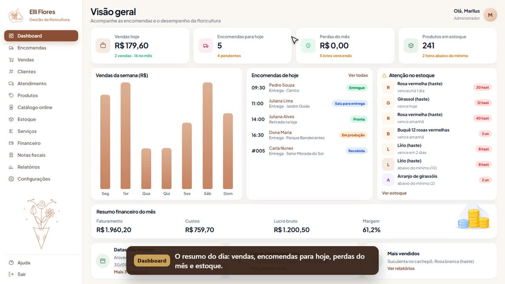 |

| Encomendas | Atendimento por WhatsApp |
|---|---|
| 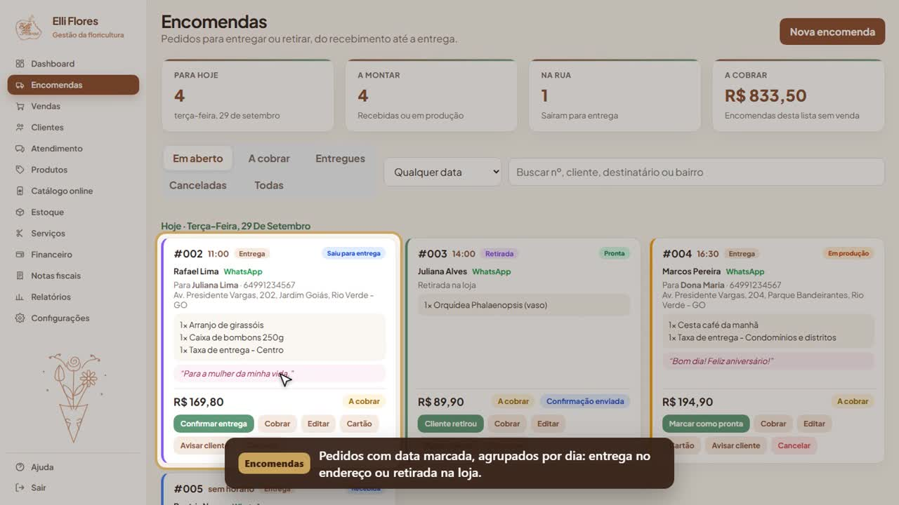 | 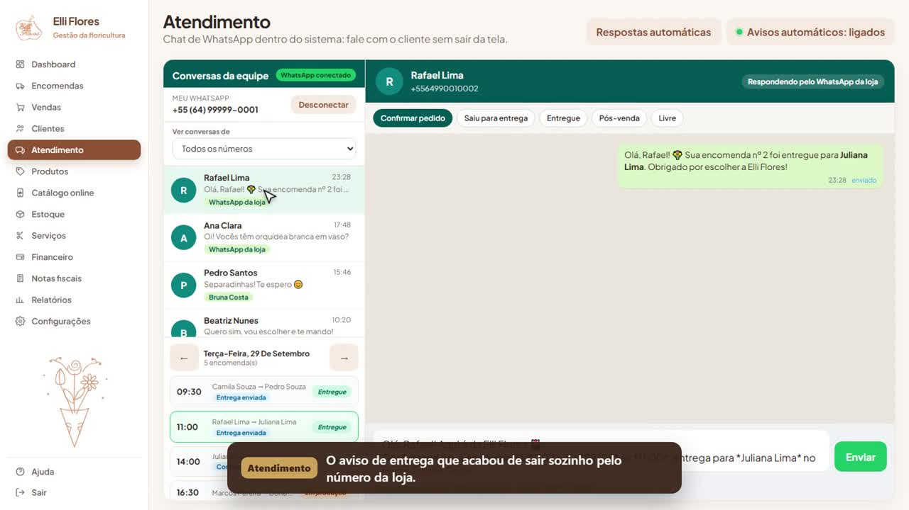 |

| Vendas (PDV) | Estoque com validade |
|---|---|
| 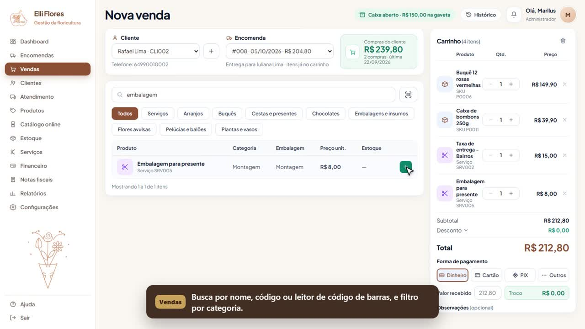 | 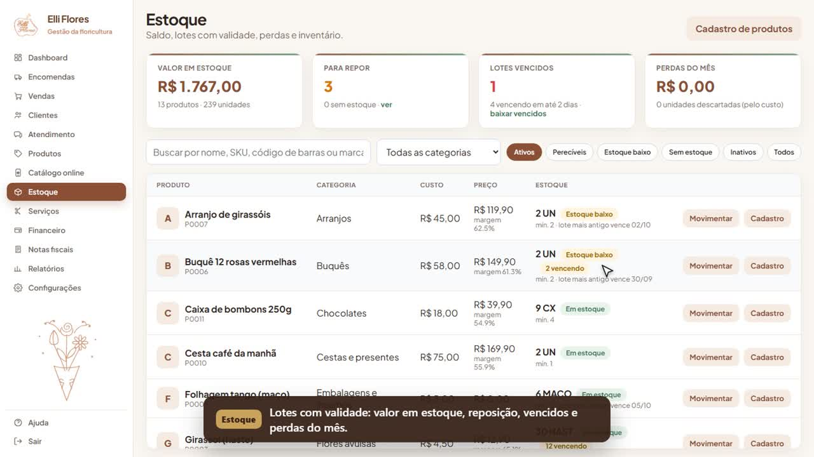 |

| Clientes e datas especiais | Financeiro |
|---|---|
| 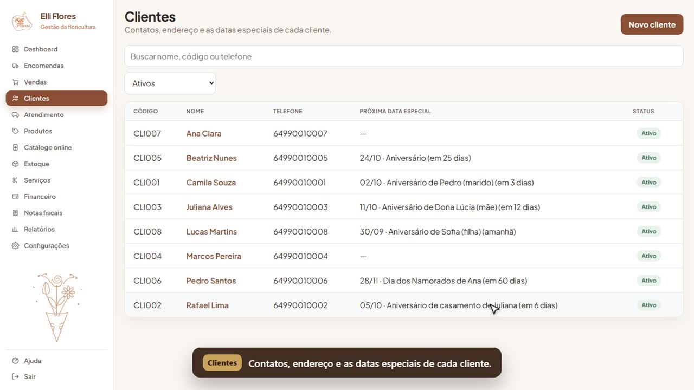 | 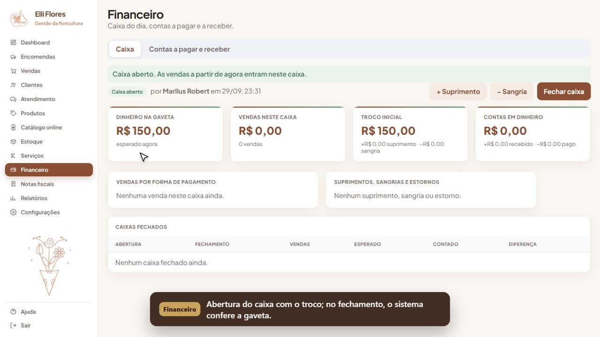 |

| Catálogo online (cliente final) | Produtos |
|---|---|
| 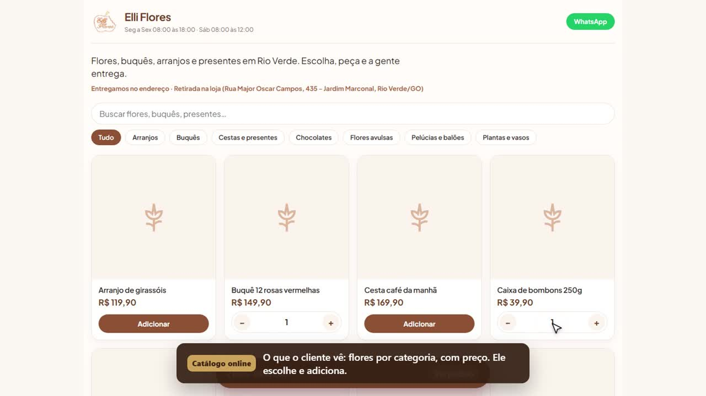 | 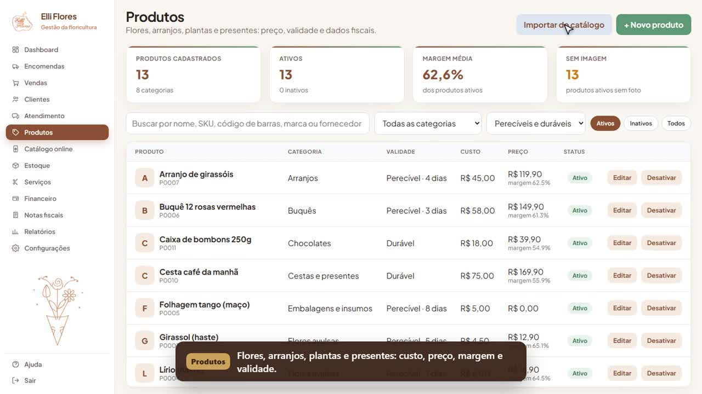 |

| Relatórios | |
|---|---|
| 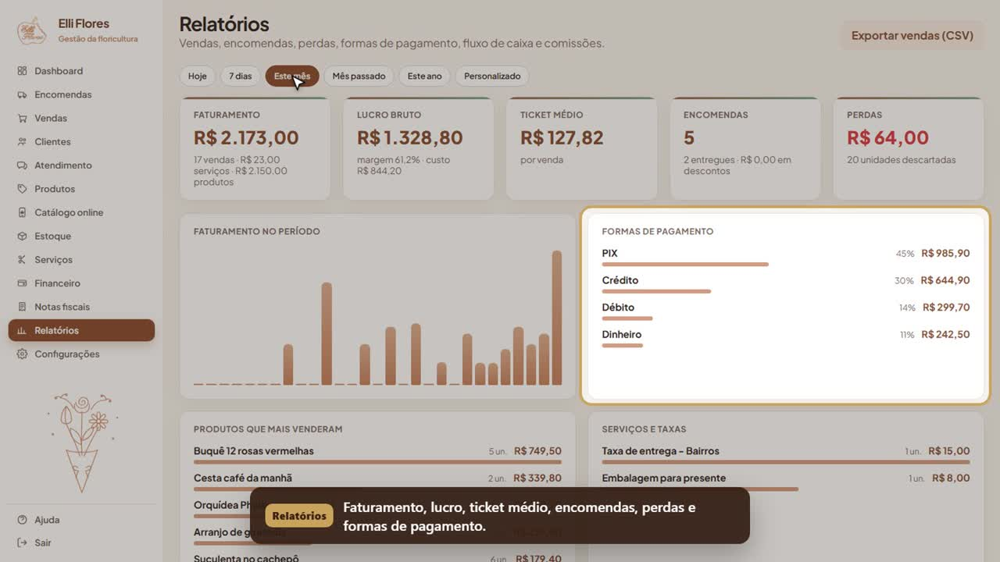 | |

### Catálogo exclusivo de atacado

| Entrada do lojista | Vitrine com preço de atacado |
|---|---|
| 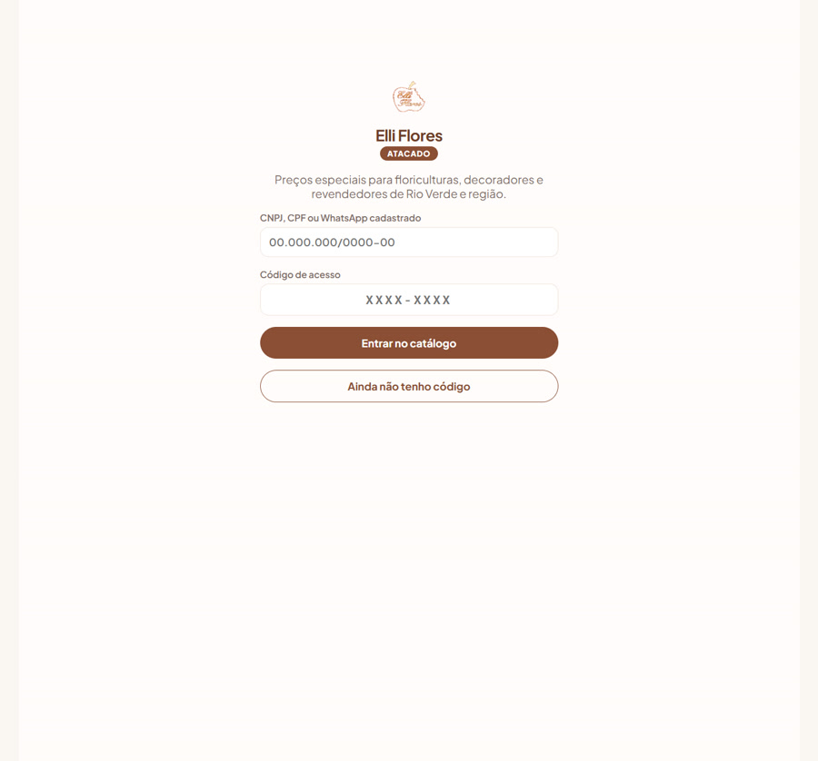 | 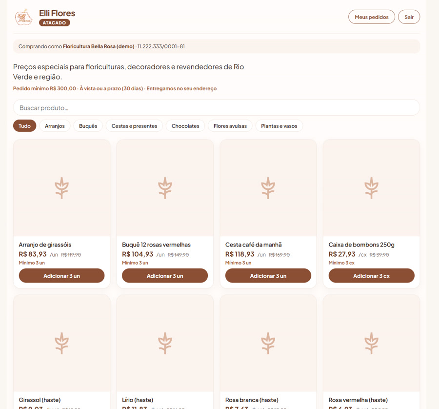 |

| Carrinho com mínimo e economia | Entrega e pagamento a prazo |
|---|---|
| 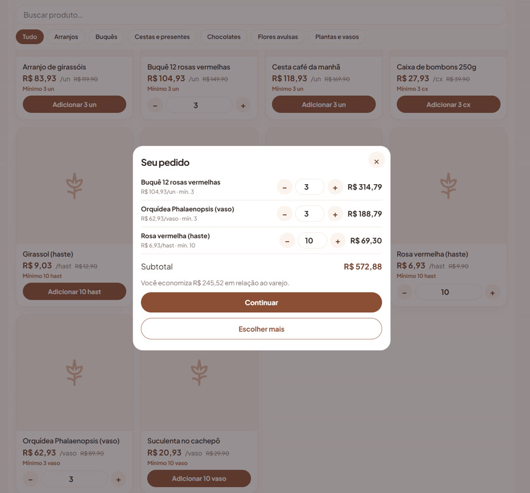 | 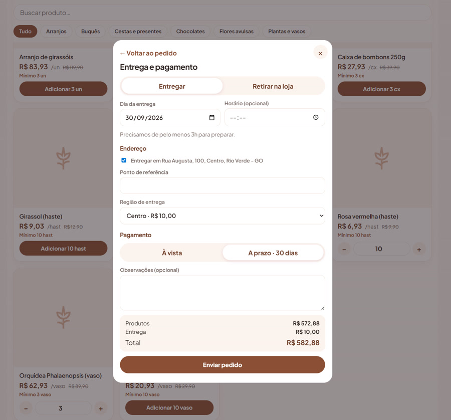 |

## Funcionalidades

- **Painel**: vendas do dia, encomendas para hoje, perdas do mês, estoque, vendas da semana e alertas de validade.
- **Encomendas** agrupadas por dia, entrega ou retirada, com andamento (recebida, em produção, pronta, saiu para entrega, entregue) e aviso automático ao cliente pelo WhatsApp.
- **Vendas (PDV)**: busca por nome, código ou leitor de código de barras, encomenda puxada para o carrinho, formas de pagamento, caixa com abertura, sangria, suprimento e fechamento conferido.
- **Estoque de perecíveis**: lotes com validade, vencidos, reposição e registro de perdas.
- **Clientes com datas especiais** (aniversários, casamento, namorados) e lembrete para oferecer flores na data.
- **Financeiro**: caixa do dia, contas a pagar e a receber.
- **Relatórios**: faturamento, lucro, ticket médio, perdas, formas de pagamento, produtos mais vendidos e exportação CSV.
- **Catálogo online**: o cliente escolhe, faz o pedido e ele vira encomenda no sistema.
- **Importação de catálogo** a partir de outro sistema (Encanto) via API, com normalização de categorias e unidades.
- **Atacado para vendedor externo**:
  - catálogo exclusivo em que o lojista entra com CNPJ/CPF ou WhatsApp e um código de acesso;
  - preço de atacado e quantidade mínima por produto, pedido mínimo da loja;
  - pedido feito pelo lojista ou pelo vendedor, à vista ou a prazo (vira conta a receber com o prazo do lojista);
  - comissão de atacado por vendedor e cada vendedor vê só a própria carteira.
- **Notas fiscais**: NFC-e e NF-e pela API da Focus NFe, com modo simulado para treinar e DANFE em PDF.
- **Atendimento por WhatsApp** dentro do sistema, com respostas automáticas e avisos de encomenda.
- **Usuários por grupo** com permissão por tela e ação.

## Arquitetura e tecnologias

| Camada | Tecnologias |
|---|---|
| Backend | Python, FastAPI, SQLAlchemy 2, Alembic, Pydantic, JWT, bcrypt |
| Banco | PostgreSQL (migrações versionadas) |
| Frontend | Next.js 15, React, TypeScript |
| Integrações | Evolution API (WhatsApp), Focus NFe (fiscal), ViaCEP |
| Infra | Docker Compose |
| Qualidade | 156 testes automatizados (pytest), incluindo checagem de que as migrações batem com os modelos |

## Autor

**Marllus Robert dos Reis Lacerda** — Desenvolvedor Full Stack | Engenharia de Dados | Python
[LinkedIn](https://www.linkedin.com/in/marlus-robert-075b472b9) · [GitHub](https://github.com/MarllusRobert) · marllusrobertrv2@gmail.com
